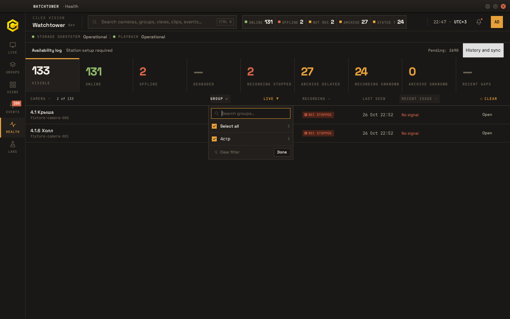
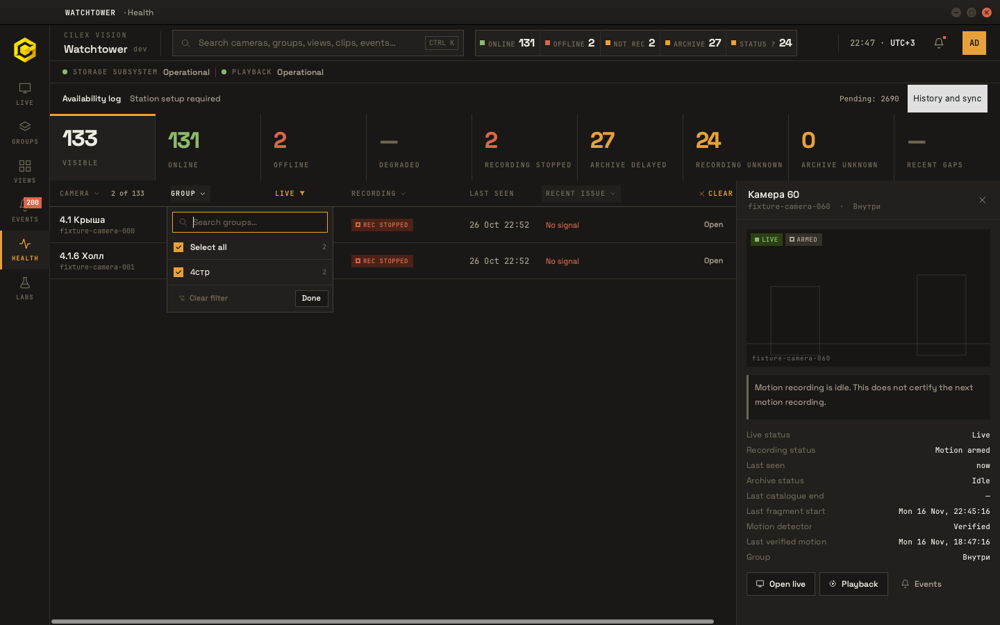
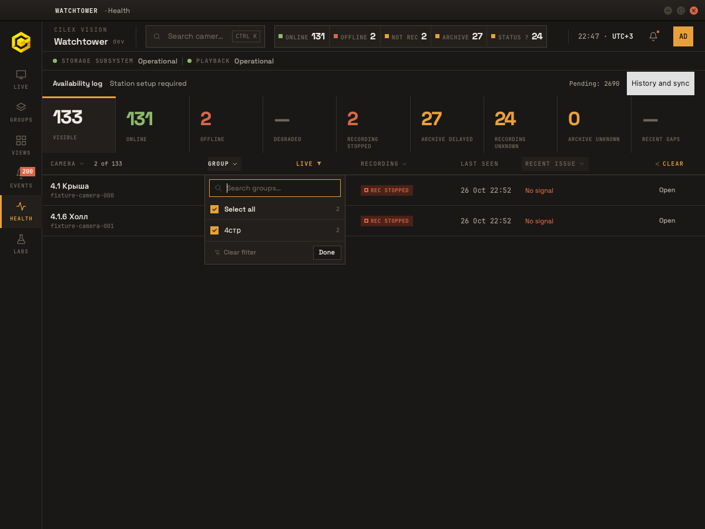
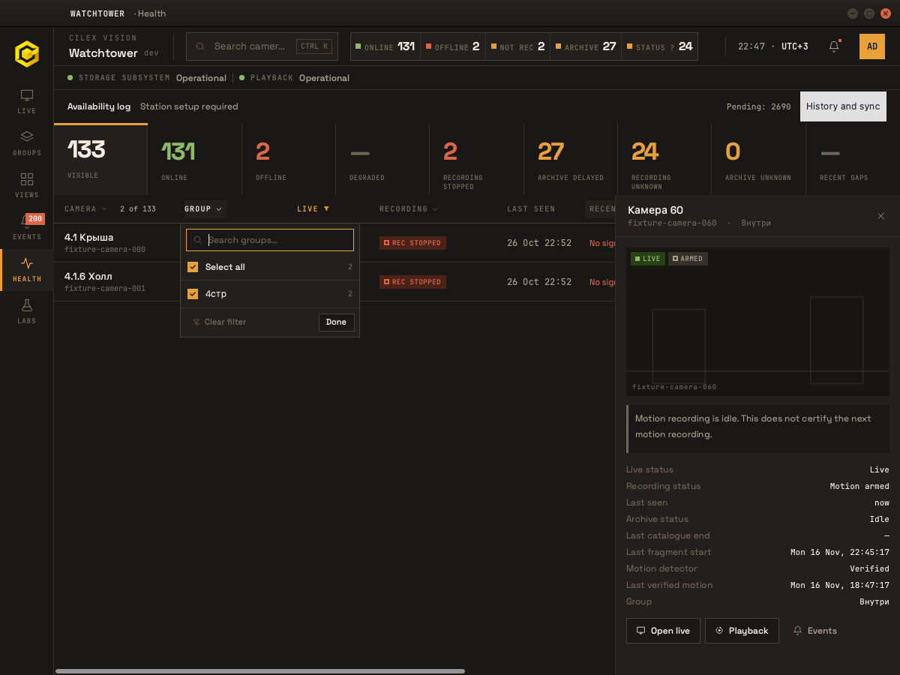
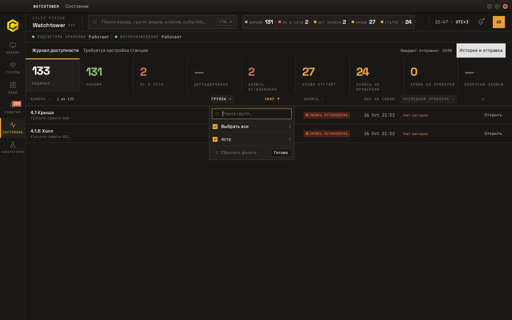
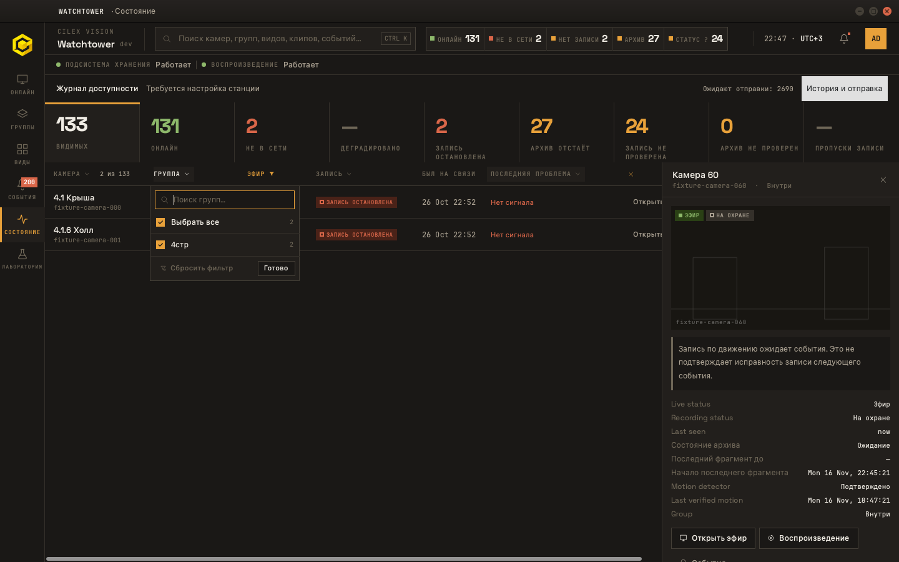
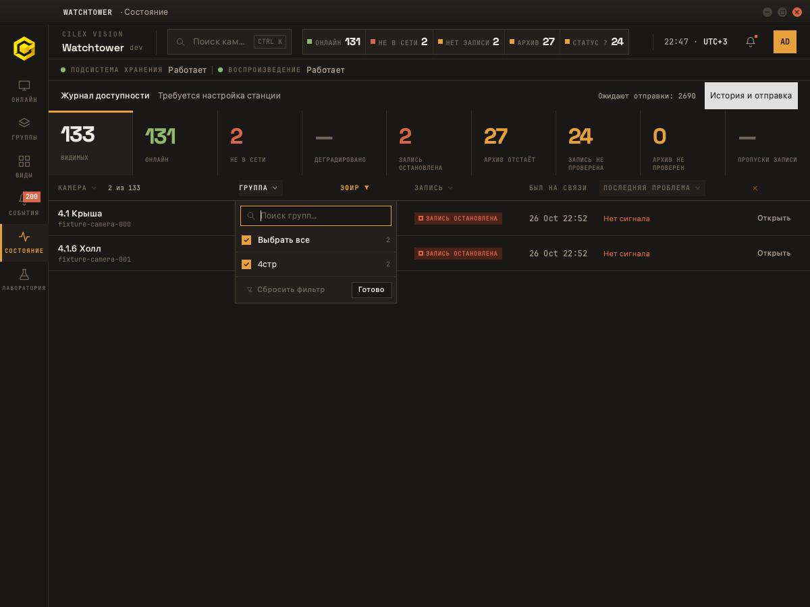
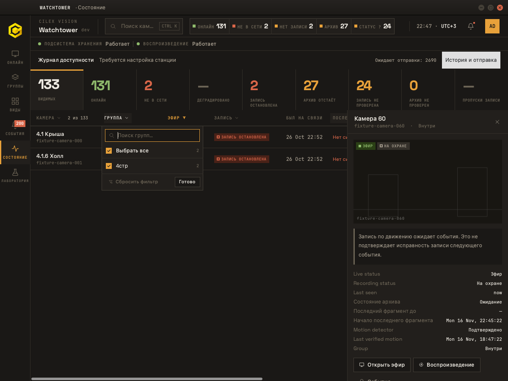

# Health column filters — acceptance evidence

Verified on macOS / Apple Silicon with Qt 6.11.1 on 16 November 2026.
The supplied [handoff](../../../designs/handoff-health-column-filters/IMPLEMENTATION_PROMPT.md)
was read in its required order. Its HTML prototype was served over localhost
and exercised in native Chrome with the default instant application, always
visible header icons and enabled counts.

## Scope and behavior

The five header menus, derived row list, empty-state action and RU copy are
implemented in HealthScreen.qml. HealthFilters.js owns stable untranslated
category keys; CMake registers that resource. Icon.qml adds the required filled
funnel and separate filter glyphs without changing existing icons. Metric
cards, subsystem strips, shell and details retain their existing styling.

The incoming RecordingStatusBadge fix is retained unchanged. `recCategory()` follows its precedence:
disabled, stopped, archive failure and progressing, then fresh v1 idle/unknown
health before legacy states and armed qualifiers. Changing ages collapse to ARMED; silent/absent/old
segments collapse to ARMED · no motion. NOT READY and ARCHIVE DELAY remain
distinct. Tests compare with the shipping badge across 735 state/health/freshness
combinations and additional motion/age/invalid-date cases.

Unchanged polls keep the existing array and model revision. Changed results
retain the top visible camera and its row offset when it still exists, or
clamp the previous offset when it does not. Horizontal offset is retained too.

**Narrow-table interpretation:** the requested fixed columns plus a 380 px
detail panel cannot fit at 1200 px. The Camera column has a 160 px minimum and
stays pinned with its N-of-M count; the other columns scroll horizontally at
their specified widths. Dropdowns clamp to the visible table with an 8 px
inset and do not extend beneath details. This follows the implementation
assumption stated in chat after the optional layout question remained unanswered.

**Inclusion-filter behavior to retain:** a newly appearing category is unchecked
and excluded while an inclusion filter is active. Reopening the menu exposes it
for selection. Clearing the filter includes future categories again. This is
deliberately the handoff's inclusion model, rather than an exclusion model.

## Done-when checklist

- [x] All five triggers: idle, hover, open and filtered; specified popup widths,
  24 px trigger geometry, negative left inset and header/cell alignment checked
  in all four size/panel layouts in each locale. `test_matrix` exercises them.
- [x] Instant uncheck/recheck and empty selections. Selecting all known keys
  normalizes to null and restores the idle header (`test_instantApplyAndNormalization`).
- [x] Cascading values/counts: OFFLINE leaves only `4стр` with count 2 in Group.
  Hidden included keys survive cascade changes (`test_cascadeAndHiddenIncludedKeys`).
- [x] Camera search covers case-insensitive names and IDs, duplicate names use
  distinct IDs, Enter keeps matches and N-of-M is correct. No-match Enter stays
  open, matching the prototype (`test_cameraSearchNamesIdsDuplicateNamesAndEnter`).
- [x] Hover Only selects one value. Select all has checked/mixed/unchecked states
  and changes only search results (`test_searchSelectAllOnlyAndFooter`).
- [x] Esc, outside click, Done and enabled/disabled Clear filter; same-trigger
  toggling and switching directly between columns (`test_onePopupToggleEscapeAndOutside`).
- [x] Metric cards AND with column filters and keep them. Column changes preserve
  selection; existing metric behavior clears selection. Section hiding preserves
  filters (`test_metricAndSelectionLifetimeAndEmptyAction`).
- [x] Empty results show the existing Nothing here state with Clear column
  filters; the action clears columns while keeping the active metric.
- [x] Two actual 15-second background polls preserve scroll and model revision
  with an active filter (`test_twoRealBackgroundPolls`). Removing an earlier
  row also preserves the top camera (`test_newKeysRemainExcludedAndBackgroundPollsKeepScroll`).
- [x] 1440×900 and 1200×900, detail panel open and closed, English and Russian.
  Reviewed screenshots below include Cyrillic fallback, RU icon-only clear,
  popup bounds and N-of-M. The full interaction suite runs in each combination.

## Verification and limits

All eight complete runs passed: 16 Qt cases per run, 128 total, zero failures.
The count includes each run's setup and cleanup cases. Outputs are local under
`/tmp/cilex-health-integration-{en|ru}-{1440|1200}-{open|closed}`.

| Locale | Width × height | Details closed | Details open |
|---|---|---|---|
| EN | 1440×900 | 16 / 0 failures | 16 / 0 failures |
| EN | 1200×900 | 16 / 0 failures | 16 / 0 failures |
| RU | 1440×900 | 16 / 0 failures | 16 / 0 failures |
| RU | 1200×900 | 16 / 0 failures | 16 / 0 failures |

The [native Qt Quick Test suite](../../../tools/tests/health-column-filters/README.md)
uses the shipping QML, production fonts and Russian translation file with
133 synthetic cameras and inert services. These are test renders, not live
fleet screenshots. The standalone runner maps the existing shell logo resource
to its original PNG; no other copied production UI source is changed.

Actual project CMake configuration and native Qt cache generation passed for
HealthScreen.qml, HealthFilters.js and Icon.qml in an isolated Release build.
`git diff --check` passed. No full application link, Windows/Linux native build,
DMG build, installation or service operation is claimed by this verification.
Raw test logs, XML and build outputs remain outside the repository.

Publication at delivery is blocked: `git pull --rebase origin main` reports
`Could not resolve host: github.com`; therefore the chained push was not run.
The GitHub connector returns 404 for `cilex-software/cilex-watchtower`.
Native Terminal access is rejected by the computer-use tool for safety reasons.
The task is committed locally on main as version 1.1.805; remote delivery is
not verified. Existing unrelated scratchpad files remain untouched and untracked.

## Rebase integration — 16 November 2026

Resolved both overlapping files by retaining both status entries and combining
canonical selection refresh with derived filtered rows. A missing model clears
selection and filtered rows. Filtering a camera out does not remove an existing
canonical selection; deletion of that exact backend ID still clears it.

HealthFilters now mirrors the incoming badge's fresh v1 health precedence:
legacy Disabled no longer overrides fresh idle/progressing/unknown, and fresh
idle does not use the legacy VMD/catalogue warning heuristic. Expired health
keeps the conservative legacy fallback. Badge source is unchanged by integration.
The category regression covers legacy, expired v1 and fresh v1 observations.
The incoming native RecordingIdleDisplay suite passes 22/22 on Qt 6.11.1;
the eight complete filter runs pass again, 128 cases with zero failures.
Source-scan-safe template strings replace unquoted test placeholders; this
avoids QML import scanner syntax warnings without changing fixture behavior.
Version is advanced to 1.1.805 after the incoming 1.1.804 commit.

## Screenshot matrix

Each screenshot shows Live = OFFLINE and the resulting Group checklist with
only `4стр` (2). “Open/closed” refers to the camera detail panel.

| Size | Details | English | Russian |
|---|---|---|---|
| 1440×900 | Closed | [EN](health-en-1440-closed.png) | [RU](health-ru-1440-closed.png) |
| 1440×900 | Open | [EN](health-en-1440-open.png) | [RU](health-ru-1440-open.png) |
| 1200×900 | Closed | [EN](health-en-1200-closed.png) | [RU](health-ru-1200-closed.png) |
| 1200×900 | Open | [EN](health-en-1200-open.png) | [RU](health-ru-1200-open.png) |

English, 1440×900, details closed:

English, 1440×900, details open:

English, 1200×900, details closed:

English, 1200×900, details open:

Russian, 1440×900, details closed:

Russian, 1440×900, details open:

Russian, 1200×900, details closed:

Russian, 1200×900, details open:

Additional states:

| State | English | Russian |
|---|---|---|
| Recording categories | [EN](recording-en-1440-open.png) | [RU](recording-ru-1440-open.png) |
| Empty result/action | [EN](empty-en-1200-open.png) | [RU](empty-ru-1200-open.png) |
| Duplicate-name search | [EN](camera-search-en.png) | [RU](camera-search-ru.png) |
| Pinned count after horizontal scroll | [EN](scroll-en-1200-open.png) | [RU](scroll-ru-1200-open.png) |
