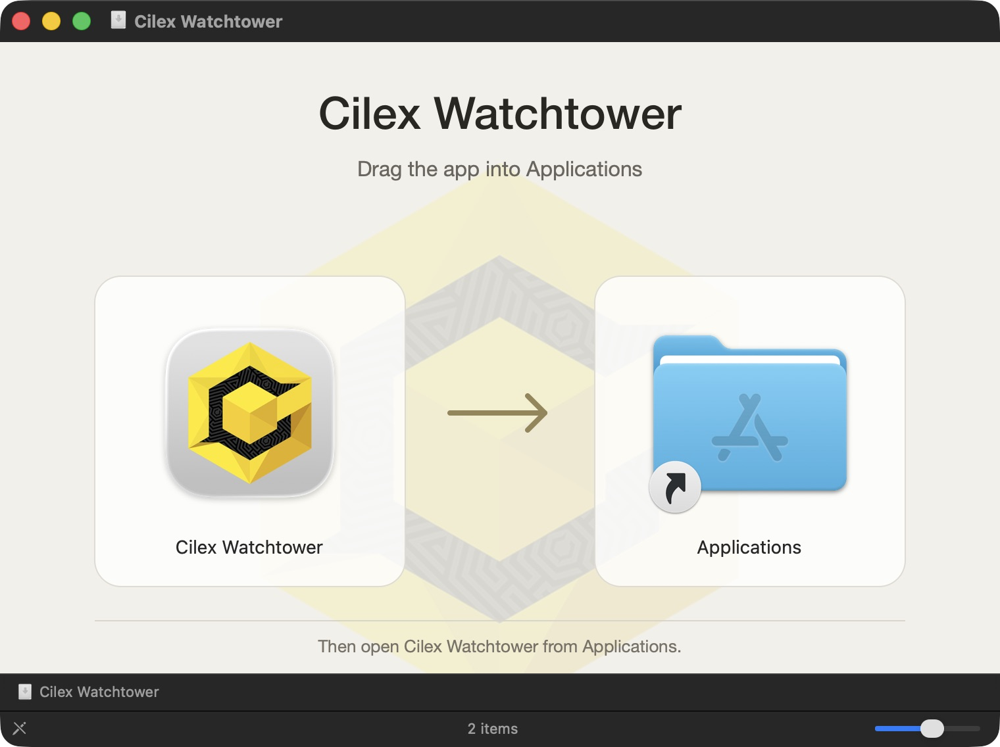

# Branded macOS drag installer — 17 November 2026

The DMG now uses 160 point native icons, two matching icon cards, a drag arrow
and a low-opacity corporate-logo watermark. The source logo is unchanged.
The background contains 760×480 and 1520×960 pixel representations at 72 and
144 DPI in one TIFF, so Finder uses the appropriate resolution on Retina Macs.
The SVG and maintainer renderer are kept with the committed artwork; normal
builds copy the TIFF and require no new artwork-generation dependency.

Finder metadata now includes the complete window/sidebar and icon-background
colour fields used by the upstream [dmgbuild writer](https://github.com/dmgbuild/dmgbuild/blob/main/src/dmgbuild/core.py).
The background reference uses Apple's full
[FSNewAlias](https://developer.apple.com/documentation/coreservices/1444363-fsnewalias)
record, generated on the mounted final image. Icons are centred at (190, 282)
and (570, 282). The saved window frame is 760×568 points, allowing the complete
480 point artwork plus Finder's title, path and status bars.

## Native verification

Opened the resulting compressed read-only DMG in Finder on this Mac. The final
accessibility tree contains exactly the two installer icons and **no horizontal
or vertical scroll bar**. The full title, arrow, icons, filenames and footer are
visible together. The saved screenshot is the real Finder window, not a mockup.

The bottom-right control is Finder's icon-size slider in its status bar. It is
also present in the operator's balenaEtcher example. On this Mac Finder kept
its global path/status bars visible despite the DMG's false hide flags. The
window accommodates them; global Finder preferences were not changed.

The earlier incomplete view settings rendered small icons without a background.
The corrected icon settings/full alias/TIFF display the new artwork natively.
An intermediate window still clipped the footer while the global bars were
present; the final 760×568 frame removes that scroll overflow. This native
observation is the basis for the frame size, rather than a serialization-only
test. Different Finder preferences can leave additional background margin.

## Existing-package DMG

The operator's existing 1.1.810 app and deployment payload were preserved in:

`~/Downloads/CilexInstallers/2026-11-17-Branded-Window/CilexWatchtower-1.1.810-arm64-development.dmg`

SHA-256: `061e2d8b527efeefe20b800ff5a31f7f6e6a6736f269f2edf683f61d5539d4da`.
A matching `.sha256` file is beside it. This is an unsigned internal installer
with revised presentation, **not a newly compiled application**. Its original
manifest/source provenance remains unchanged. Byte/metadata inventories of all
4,536 signed app entries and the hidden deployment payload match the original
1.1.810 package. `codesign --verify --deep --strict` and `hdiutil verify` pass.

The original DMG was converted to a separate writable image; only its Finder
metadata/background were changed. This tool environment can convert images but
cannot attach them through hdiutil (`Device not configured`), so Finder mounted
the test copies. A normal hdiutil detach unmounted the filesystem but could not
eject its device (`Inappropriate ioctl for device`); a closed filesystem copy
was used for compression. The final frame was applied to the unique active
12,292-byte Finder metadata extent in that unmounted copy, preserving its alias
and every app/helper byte. Native mounting, inventory comparison, signature,
checksum and visual checks were repeated on the final compressed output.
The final alias was also converted through Apple's CoreFoundation bookmark
API and resolved with UI and mounting disabled: it identifies
`/Volumes/Cilex Watchtower/.background/install.tiff`, not a staging artwork file.
The normal builder continues to configure the mounted final volume directly.

No app was installed or launched, and no Warden or other service was changed.
No full application compilation or hardware-export acceptance is claimed here.
Future normal committed-source DMG builds include these presentation changes.

## Regression coverage

The existing drag-installer suite passes all 24 cases, including independently
decoding the Finder metadata, checking icon/label extents, retaining only two
visible entries, copying the TIFF, preserving app inventory, reconstructing
scripted installation payloads, failure ejection and service-handoff safeguards.
The closure regression also checks that TIFF artwork survives helper freezing
and repeated provenance generation: 25 cases run, 24 pass and the existing
case-sensitive filename test skips on this case-insensitive Mac filesystem.
Temporary compiler outputs, intermediate
images and raw logs are outside Git.

The source change is committed locally as version 1.1.811. Its publication
attempt is blocked by `Could not resolve host: github.com` during
`git pull --rebase origin main`; the chained push did not run. Remote delivery
is not verified. The revised local DMG above is available independently.
